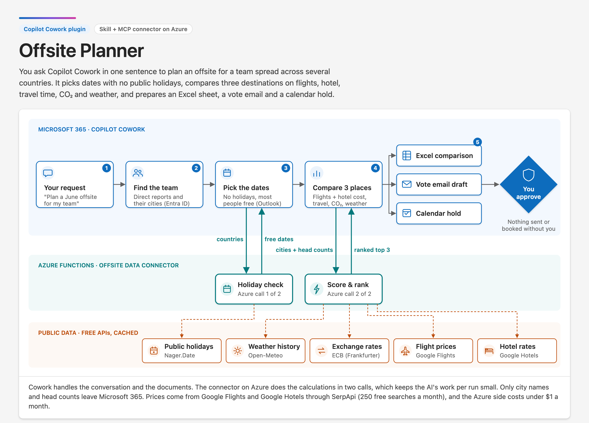

# Offsite Planner

A Microsoft 365 Copilot Cowork plugin that plans a team offsite across countries.

## Summary

Offsite Planner is a Copilot Cowork plugin. You ask in one sentence, for example *"Plan a June 2027 offsite for my team. Compare three destinations."*, and Cowork:

* finds your team (direct reports) and the city each person works in,
* picks dates that avoid public holidays in every country involved and suit most calendars,
* compares three destinations on flights, hotel, travel time, CO₂ and typical weather, and ranks them,
* creates an Excel comparison, drafts a vote email and proposes a calendar hold.

It plans only. It never books flights or hotels, and it sends the email or creates the calendar hold only after you confirm.

The plugin contains one skill (`offsite-planner`) and one remote MCP connector (`Offsite Data`) that runs on Azure Functions.



## Version history

Version|Date|Comments
-------|----|--------
1.1.0|2026-11-11|Hotel rates (Google Hotels) added to the comparison and the total cost
1.0.0|2026-11-11|Initial release

## Prerequisites

* Microsoft 365 tenant with Copilot Cowork enabled for your user (Microsoft 365 Copilot and Frontier licenses, Copilot Credits, the Anthropic subprocessor allowed)
* Permission to upload custom plugins in Cowork
* Azure subscription where you can create a resource group (Contributor is enough)
* [Node.js](https://nodejs.org) 22 or later
* [Azure Developer CLI](https://learn.microsoft.com/azure/developer/azure-developer-cli/install-azd) (`azd`) and [Azure CLI](https://learn.microsoft.com/cli/azure/install-azure-cli) (`az`)
* [Azure Functions Core Tools](https://learn.microsoft.com/azure/azure-functions/functions-run-local), for local runs
* A bash shell with `python3`, `zip` and `uuidgen` (macOS and Linux have them; on Windows use WSL)
* Optional: [wiqd](https://www.npmjs.com/package/@microsoft/wiqd) (`npm install -g @microsoft/wiqd`) to validate the plugin package
* Optional: a [SerpApi](https://serpapi.com) account for live flight and hotel prices. Without it the connector uses built-in test estimates and labels them as test data.

## Minimal path to awesome

```bash
git clone https://github.com/xenophobentx/offsite-planner.git
cd offsite-planner
```

### 1. Deploy the connector to Azure

From the repository root:

```bash
az login
azd auth login
azd env new offsite-dev
azd env set AZURE_LOCATION westeurope
azd env set AZURE_PRINCIPAL_ID "$(az ad signed-in-user show --query id -o tsv)"
azd env set BUDGET_START_DATE "$(date +%Y-%m)-01"
azd up
```

`azd up` creates one resource group with a Flex Consumption Function App, a storage account (deployment package and API cache table), a Key Vault, Application Insights with a 0.1 GB daily cap, and a 5 USD monthly budget alert. Note the `SERVICE_MCP_ENDPOINT` output.

If your subscription requires an `Owner` tag on resource groups, also run `azd env set OWNER_TAG <you>` before `azd up`.

### 2. Optional: live flight and hotel prices

`azd env get-values` prints `AZURE_KEY_VAULT_NAME` and `SERVICE_MCP_NAME`.

```bash
az keyvault secret set --vault-name <AZURE_KEY_VAULT_NAME> --name serpapi-key --value "$(pbpaste)"
azd env set FLIGHT_PROVIDER serpapi
azd env set HOTEL_PROVIDER serpapi
azd provision
az functionapp restart -g rg-offsite-planner -n <SERVICE_MCP_NAME>
```

`$(pbpaste)` reads the key from the clipboard on macOS, so it does not end up in your shell history. On Linux use `$(xclip -o -selection clipboard)`; or run `read -s SERPAPI_KEY` and pass `"$SERPAPI_KEY"`.

### 3. Package and upload the plugin

* Run `cp plugin/env/.env.dev.sample plugin/env/.env.dev`, then set `MCP_SERVER_URL` in `plugin/env/.env.dev` to the `SERVICE_MCP_ENDPOINT` value. `.env.dev` is gitignored, so the URL of your anonymous endpoint stays out of the repo.
* Run `plugin/scripts/pack.sh`. It writes `plugin/appPackage/build/offsite-planner.zip` and stores a new `TEAMS_APP_ID` in `.env.dev` on the first run. Keep that ID, so that later uploads update the same plugin.
* Optional: `wiqd plugin validate --package-file plugin/appPackage/build/offsite-planner.zip`
* In Cowork, select **+** > **Plug-ins**, upload the zip, and make sure **Offsite Planner** is turned on.

### 4. Try it

In Cowork, type:

```
Plan a June 2027 offsite for my team. Compare three destinations.
```

If your team's profiles have no city, Cowork asks once where people are based. Type `/cost` afterwards to see the Copilot Credits the task used.

### Run the connector locally

```bash
cd mcp-server
cp local.settings.sample.json local.settings.json
npm install
npm test
npm run build
func start
```

The MCP endpoint is then `http://localhost:7071/mcp`.

### Remove everything

```bash
azd down --purge
```

`--purge` also deletes the soft-deleted Key Vault. Without it, the vault name stays reserved for 7 days and a new `azd up` with the same environment fails.

## Features

The design goal is a cheap and predictable run. Cowork bills by tokens, so the model only collects inputs and writes documents. Data gathering, currency conversion, CO₂ and scoring run in code, in two tool calls:

* `plan_dates` returns up to five holiday-free windows (default: two nights, arriving on Tuesday) for the given countries, using [Nager.Date](https://date.nager.at).
* `compare_destinations` takes origins grouped by city (`[{city, count}]`, never names), the dates, and optionally three destinations, scoring weights and a room count. In one call it:
  * picks three destinations if none are given,
  * fetches round-trip flights for every origin and destination (for example, 4 origin cities × 3 destinations = 12 routes, at most 6 at a time),
  * fetches hotel rates and picks the cheapest hotel rated 4.0 or higher in the 3–4 star class,
  * converts prices to EUR with ECB rates ([Frankfurter](https://frankfurter.dev)),
  * estimates CO₂ from distance,
  * reads typical weather from the same month in the last three years ([Open-Meteo](https://open-meteo.com) archive),
  * scores and ranks the destinations (cost 35%, travel time 25%, weather 15%, CO₂ 15%, stops 10%; each criterion relative to the best option).

The answer is a compact JSON table of about 4 KB. External answers are cached in Azure Table storage (holidays one year, weather 30 days, exchange rates one day, flights and hotels six hours).

In our test (4 origin cities), one full run used about 47 Copilot Credits and 15 SerpApi searches. The SerpApi free plan has 250 searches a month.

### Privacy

Only city names, head counts, country codes and dates leave Microsoft 365. Names, email addresses and calendars stay with Cowork. The connector stores nothing about users; its cache holds only the public API answers (holidays, weather, exchange rates, flight and hotel prices).

With this plugin you can see how to extend Microsoft 365 Copilot Cowork with a plugin that:

* combines a skill with a remote MCP connector in one package,
* moves deterministic work out of the model and into the connector to keep credit use low,
* hosts an MCP server built with the official TypeScript SDK on Azure Functions Flex Consumption, deployed with `azd` and Bicep.

### Limitations

* The connector uses anonymous auth (`None`), so anyone with the URL can call it. Use it for demos, or add Microsoft Entra SSO before wider use.
* Hosting MCP SDK servers on Azure Functions is in preview.
* Cowork may read user profiles from a copy that updates later than Microsoft Entra ID. Cities you set in Entra ID on the same day may not be visible yet.
* Flight CO₂ is an estimate: great-circle distance + 8%, × 0.15 kg CO₂e per passenger-km, × 2 for the round trip, +10% per stop.

## Documentation

* [How the connector decides](./docs/how-it-works.md): which three destinations it picks, how it ranks them, and what one run costs.
* [Who calls Azure, and when?](./docs/offsite-planner-azure-steps.html): animated, step-by-step diagram. Download the file and open it in a browser.
* [Flow diagram](./docs/offsite-planner-flow.html): download and open in a browser, or see the [PNG](./assets/flow.png).
* [Flight data source decision](./research/flights.md): why SerpApi, and sample responses of the free APIs.

## Repository layout

| Folder | Contents |
|---|---|
| `plugin/` | Cowork plugin package: manifest, the `offsite-planner` skill, connector tool descriptions, `scripts/pack.sh`. The `m365agents*.yml` files are for the Microsoft 365 Agents Toolkit and are not needed for the steps above. |
| `mcp-server/` | MCP server (TypeScript, official MCP SDK) run as an Azure Functions custom handler |
| `infra/` | Bicep for `azd up` |
| `docs/` | Explanations and diagrams |
| `research/` | Data source notes and sample API responses |

## License

[MIT](./LICENSE)

## Disclaimer

**THIS CODE IS PROVIDED *AS IS* WITHOUT WARRANTY OF ANY KIND, EITHER EXPRESS OR IMPLIED, INCLUDING ANY IMPLIED WARRANTIES OF FITNESS FOR A PARTICULAR PURPOSE, MERCHANTABILITY, OR NON-INFRINGEMENT.**
